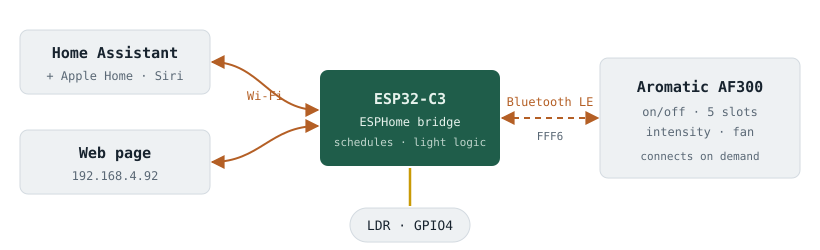
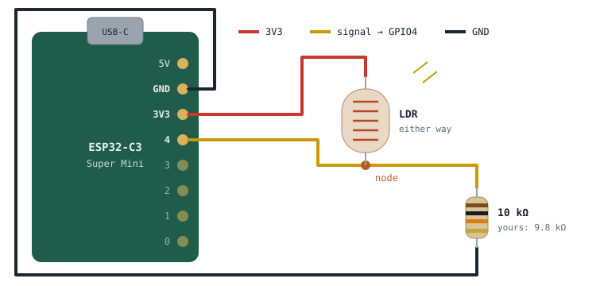
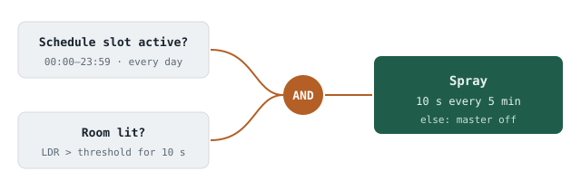

# Aromatic BLE → Home Assistant bridge

Control a Bluetooth **Aromatic** scent diffuser from Home Assistant using a
cheap ESP32 running [ESPHome](https://esphome.io). The ESP32 talks Bluetooth LE
to the diffuser and WiFi to Home Assistant.



**دليل بالعربي مع الصور والرسومات:** [docs/guide-ar.md](docs/guide-ar.md)

> Unofficial project, not affiliated with Aromatic Families Trading Est.
> The protocol was worked out for interoperability with a device the author owns.

## What you get

Everything shows up in Home Assistant and on the bridge's own web page
(`http://aromatic-bridge.local`, login from `secrets.yaml`):

| Group | Entities |
|---|---|
| **Diffuser** | Master on/off · Status (`Active · slot 1 · 10s/200s`, `Idle · next 17:30`, `Off · dark`) · Fan level 0–4 |
| **Room light** *(optional LDR)* | Light control · Room lit · Room light % · Light threshold |
| **Slot 1–5** | Enabled · Start · End · Days (`Every day`, `Sun,Mon,Thu`) · Intensity (Level 1–4 / Custom) · Custom spray s · Custom pause s |
| **Oil (estimated)** | Spray time today · Oil used · Oil left · Bottle size · Oil per spray hour · Bottle refilled |
| **System** | Diffuser login · Refresh · Restart bridge · Bridge LED |

The five slots are the diffuser's own schedules, so they keep running without
WiFi or Home Assistant. Every change is written to the diffuser and then read
back from it to confirm.

**Light control** turns the diffuser on while the room is lit and off after
5 s of darkness, so it only sprays (on its schedule) when someone is there.

**BOOT button** on the ESP32: short press toggles the diffuser, a 2 s press
toggles light control. The blue LED blinks once or twice to confirm.

The bridge connects on demand (on a change, a light change, or once an hour)
and disconnects right away. The diffuser beeps on each BLE session, and the
phone app can still reach it between sessions.

## Tested hardware

| | |
|---|---|
| Diffuser | Aromatic **AF300 Smart**, protocol `CY_V3.0`, BEKEN `BK-BLE-1.0` chip |
| App | Aromatic Families (Android `com.aromatic.families`) |
| Bridge | ESP32-C3 Super Mini, ESPHome 2026.10.0 |

Other models that use the same app will probably work too. The `2D` master
switch only applies to models where the app shows a "total control" switch; see
[PROTOCOL.md](PROTOCOL.md).

## Setup

1. Install ESPHome (`pip install esphome`, `uv tool install esphome`, or the
   Home Assistant add-on).
2. Copy `secrets.yaml.example` to `secrets.yaml` and fill it in:
   - WiFi name and password
   - the diffuser's 4-digit app password (the tested unit used `0000`)
   - the diffuser's MAC address. To find it, flash `probe-1-scan.yaml` and look
     for a device named `…AROMATIC` advertising service `0xFFF0`:
     ```sh
     esphome run probe-1-scan.yaml
     ```
   - an API key: `openssl rand -base64 32`
   - a username and password for the web page
3. Close the Aromatic app on your phone. The diffuser accepts only one
   connection at a time.
4. Flash the bridge over USB once; later updates go over WiFi:
   ```sh
   esphome run aromatic-bridge.yaml
   ```
5. In Home Assistant, go to **Settings → Devices & services**. Accept the
   discovered **Aromatic** ESPHome device, or add it by IP, and paste the
   `api_encryption_key` when asked.

Place the ESP32 within a few metres of the diffuser and power it from any USB
charger.

### Optional: room light sensor

Wire an LDR and a 10 kΩ resistor to the ESP32-C3 Super Mini:

```
3V3 ── LDR ──┬── GPIO4
             └── 10 kΩ ── GND
```





Turn on **Light control** and set **Light threshold** between your covered and
lit readings. If you have no sensor, remove the `light:` line under `packages:`
in `aromatic-bridge.yaml`.

The diffuser's built-in light sensor only works in its own **Smart** mode, and
any BLE connection switches it back to Bluetooth mode. It also doesn't report
the light level over BLE, which is why the bridge uses its own LDR.

## Files

| File | |
|---|---|
| `aromatic-bridge.yaml` | The bridge firmware |
| `aromatic.h` | Protocol state, frame building and parsing (C++) |
| `slot.yaml` | One schedule slot's entities, included five times |
| `light.yaml` | Optional LDR light control |
| `PROTOCOL.md` | The reverse-engineered BLE protocol |
| `probe-*.yaml` | The step-by-step probes used to work it out |
| `docs/guide-ar.md` | Full guide in Arabic, with photos and diagrams |
| `docs/images/` | Diagrams (SVG) |

## Probes

These configs were used to reverse-engineer the protocol. They are handy if you
have a different model:

| File | What it does | Writes to the device? |
|---|---|---|
| `probe-1-scan.yaml` | Lists nearby BLE devices with services and manufacturer data | No |
| `probe-2-gatt.yaml` | Connects and lists GATT services | No |
| `probe-3-info.yaml` | Reads Device Information and battery | No |
| `probe-4-login.yaml` | Logs in and dumps every reply as hex | Login only |
| `probe-5-onoff.yaml` | OFF then ON across fresh connections, with readback | **Yes** |

All of them print to the USB log, so no WiFi is needed:
`esphome run probe-N-….yaml`.

## Safety

- Never write to service `F000FFC0-0451-4000-B000-000000000000`. It is the
  firmware-update (OAD) service, and a bad write can brick the diffuser.
- The bridge only sends the documented `8F` login, `21` time sync and `2D`
  total-control frames.

## Known limits

- The diffuser's own buttons (intensity, mode) overwrite its schedule slots.
  The bridge picks up those changes on its next read.
- There are exactly five schedule slots; that is a limit of the diffuser.
- Custom spray times below the reported 15 s minimum (e.g. 10 s) are accepted
  and stored, but whether the pump honours them exactly is untested.
- The oil figures are estimates from the schedule and spray timing. Calibrate
  **Oil per spray hour** after one full bottle.

## بالعربي

جسر يربط معطر **Aromatic** اللي يشتغل بالبلوتوث مع **Home Assistant** عن طريق
شريحة ESP32 عليها ESPHome. فيه تشغيل وإطفاء، والجداول الخمسة (الأوقات والأيام
والشدة)، والمروحة، وصفحة ويب على الشريحة نفسها، وحساس نور اختياري يخلي المعطر
يرش بس إذا الغرفة منوّرة. التفاصيل التقنية في [PROTOCOL.md](PROTOCOL.md)، والدليل الكامل بالصور في [docs/guide-ar.md](docs/guide-ar.md).

خطوات التركيب:
1. انسخ `secrets.yaml.example` باسم `secrets.yaml` وعبّه.
2. سكّر تطبيق المعطر من جوالك.
3. برمج الشريحة بأمر `esphome run aromatic-bridge.yaml`.
4. ضيف الجهاز في Home Assistant.

## License

[MIT](LICENSE)
